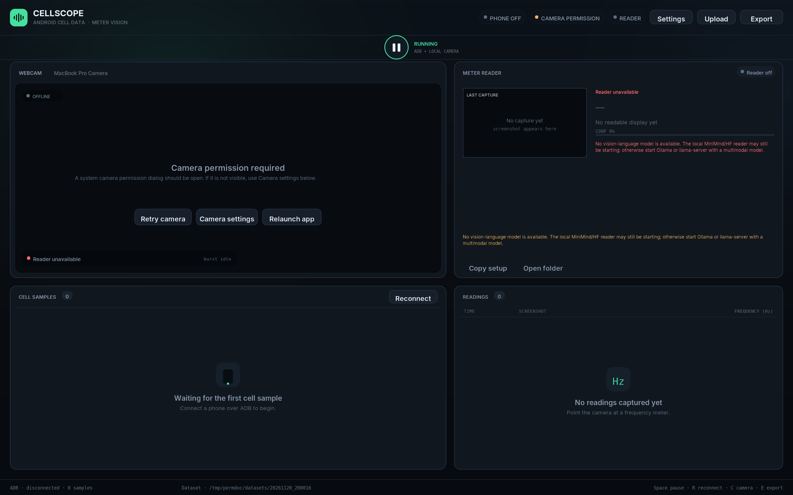
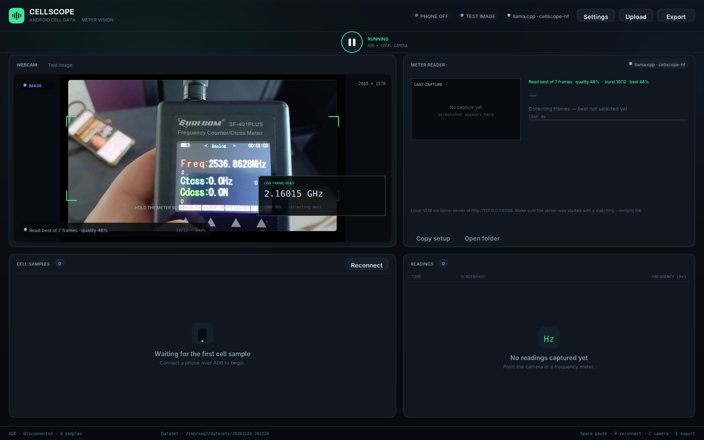
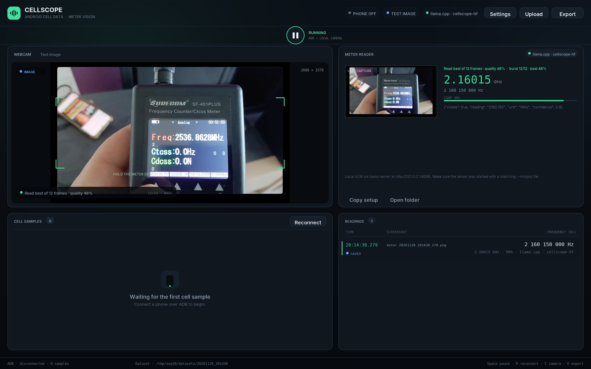

# CellScope

A cross-platform desktop C application that watches an Android phone's cellular
state and a webcam at the same time.

- **Left:** live cell samples polled from `adb` once per second (PLMN, MCC/MNC,
  TAC, eNB/CID, PCI, timing advance, NR/LTE ARFCN, band, bandwidth, CA,
  downlink/uplink centre frequencies) plus a Wi-Fi column of anonymized SSIDs
  and their RSSI in dBm.
- **Top left:** preview from the webcam attached to the local machine (never
  the Android phone), with a meter alignment guide. While a device screen is
  visible, a live card shows the reading extracted from every processed frame.
- **Top right:** best-result reader. It shows nothing while a screen is being
  collected, then displays the selected best extraction for **3 seconds**. The
  value is converted to Hz, and the exact best frame is saved.
- **Bottom right:** timestamped frequency readings, each with the filename of
  its saved screenshot.
- **Top centre:** a large play/pause control for both the local webcam pipeline
  and ADB polling.
- **On launch:** a step-by-step modal explains how to connect the phone over
  ADB. It only disappears when a device is authorized; failures show concrete
  fixes.
- **First run:** CellScope installs its own private Python runtime, ML packages,
  and MiniMind assets, then starts the local reader bridge in the background.
  A downloaded Hugging Face model recorded in `settings.json` takes precedence.

Camera frames and readings stay local. No telemetry, no cloud inference, and no
images are uploaded. The one-time runtime/model downloads come from uv's GitHub
releases, ModelScope, and Hugging Face if you download an HF model.


## Stack

| Concern | Choice |
|---|---|
| Language | C11 |
| Window / input / camera | SDL3 (3.2+ camera API) |
| 2D UI / text | SDL3 renderer + FreeType, small immediate-mode toolkit |
| ADB | `adb` subprocess, captured with a hard timeout; telephony + Wi-Fi scans |
| Reader HTTP | libcurl → Ollama or llama.cpp server (OpenAI-compatible) |
| PNG | stb_image / stb_image_write |
| Training | MiniMind-V submodule + a small Parquet converter |
| Private runtime | uv-managed CPython 3.11 + venv, auto-installed on first run |
| Local bridge | MiniMind-V or Hugging Face Transformers model behind an OpenAI-compatible HTTP endpoint |

## Build

### macOS

```bash
brew install cmake sdl3 freetype curl
cmake -S . -B build -DCMAKE_BUILD_TYPE=Release
cmake --build build -j
open build/cellscope.app
```

The bundle is ad-hoc signed by the build, with the camera entitlement and
`NSCameraUsageDescription`. Ad-hoc signatures can make macOS/TCC forget grants
between rebuilds; for repeatable camera permission, configure a stable Apple
Development/Developer ID identity:
`-DCELLSCOPE_CODESIGN_IDENTITY="Apple Development: Your Name (TEAMID)"`.

On macOS, when camera permission is still undecided, launching CellScope
automatically reopens it through LaunchServices *before the first window
is shown*. The TCC dialog therefore belongs to CellScope, not to the terminal,
IDE, or agent that started it. This is the same path as the **Relaunch app**
button and happens without user interaction; the first process exits after
handing off. The camera panel still shows **Retry camera**, **Camera settings**,
and **Relaunch app** as fallbacks. If you previously denied access, enable
**CellScope** in *System Settings → Privacy & Security → Camera*, then click
Retry.

Command-line options are handed to the relaunched instance through a
short-lived temp file, so `--vlm`, `--capture-dir`, etc. survive the handoff.
Set `CELLSCOPE_NO_AUTO_RELAUNCH=1` when debugging in Xcode/LLDB. The handoff
also covers a raw executable started from a terminal; launching the bundle with
`open` remains recommended.



### Windows

Use vcpkg for SDL3, FreeType, and libcurl:

```bat
vcpkg install
cmake -S . -B build -DCMAKE_TOOLCHAIN_FILE=%VCPKG_ROOT%\scripts\buildsystems\vcpkg.cmake
cmake --build build --config Release
build\Release\cellscope.exe
```

Windows camera access is controlled by *Settings → Privacy → Camera*. The app
shows **Camera settings** in the camera panel (it opens
`ms-settings:privacy-webcam`) plus **Retry camera**. Enable camera access for
desktop apps and for CellScope. The app keeps a console window by default for
ADB diagnostics; configure with `-DCELLSCOPE_WIN_CONSOLE=OFF` for a pure GUI
build.

### Linux

```bash
sudo apt install build-essential cmake libfreetype-dev libcurl4-openssl-dev
# SDL3 3.4+ is required for the camera API. If your distro does not package it:
#   git clone https://github.com/libsdl-org/SDL.git -b release-3.2
#   cmake -S SDL -B SDL/build -DCMAKE_BUILD_TYPE=Release && cmake --build SDL/build -j
#   sudo cmake --install SDL/build
cmake -S . -B build -DCMAKE_BUILD_TYPE=Release
cmake --build build -j
./build/cellscope
```

Linux camera access normally uses `/dev/video*` rather than an OS permission
dialog. If opening the camera fails, check that the device exists and that your
user is in the `video` group, then log out/in. Flatpak and Snap builds also need
camera permission from their sandbox/portal. The camera panel shows
**Retry camera** with the relevant hint; PipeWire/portal prompts are handled as
a pending permission state.

The user must be able to open `/dev/video*` (usually membership in the `video`
group) and must have working Android udev rules for adb.

## Run

```bash
# macOS
open build/cellscope.app
# Linux / Windows
./build/cellscope
```

Just running the binary is enough. On first use CellScope bootstraps its own
local AI runtime, downloads the model files, and starts the local reader bridge
in the background. If `settings.json` selects a downloaded Hugging Face model,
that model is served instead of MiniMind.

### First run: private Python + local reader

You do not need to install or prepare system Python, pip, virtualenv, uv, or
ModelScope by hand. On the first GUI launch (when not using `--demo`,
`--image`, or an explicit `--vlm`), CellScope:

1. downloads a `uv` launcher into its working directory;
2. installs a private CPython 3.11 under that directory;
3. creates a private virtual environment and installs
   `torch`, `torchvision`, `transformers==4.57.6`, `datasets==3.6.0`,
   `numpy==1.26.4`, `pyarrow==23.0.0`, `Pillow`, `safetensors`, `modelscope`,
   `huggingface_hub`, `accelerate`, `sentencepiece`, `protobuf`, `timm`, and
   `einops`;
4. downloads the frozen SigLIP2 vision encoder and the MiniMind language/base
   SFT weights from ModelScope;
5. starts this in the background with the private interpreter:

```bash
python scripts/serve_minimind_vlm.py \
  --minimind third_party/minimind-v \
  --save_dir ./training \
  --weight cellscope_meter \
  --port 8090
```

The bundled MiniMind source is copied once into the working directory and the
effective paths are absolute. If
`<working-directory>/training/cellscope_meter_768.pth` does not exist yet, the same bridge starts
with the downloaded baseline `sft_vlm_768.pth`; train with `--train` to replace
it with a meter-specific checkpoint. A banner shows download/install progress.
While setup runs, cell capture and the UI remain usable; meter readings start
once a VLM is available.

The single working directory is:

- macOS/Linux: `~/.cellscope`
- Windows: `%LOCALAPPDATA%\CellScope` (per-user app data; not Program Files)

Everything the app downloads lives there:

- `runtime/` — private Python, packages, `uv`, caches, `runtime/minimind/`
  (code copy plus downloaded MiniMind assets);
- `runtime/hf-models/` — downloaded Hugging Face snapshots;
- `settings.json` — app settings;
- `training/` — training output by default;
- `datasets/` — one timestamped folder per capture session;
- `cellscope.log`.

The setup log is `runtime/bootstrap.log`; the reader log is
`runtime/minimind-server.log` or `runtime/hf-server.log`. Delete `runtime/` to
force a clean runtime reinstall. Override the working directory with
`CELLSCOPE_HOME`, the runtime with `CELLSCOPE_RUNTIME_DIR`, training with
`CELLSCOPE_TRAINING_DIR`, and capture output with `--capture-dir`.

Useful flags:

```bash
# build/update the private runtime and exit (no GUI)
cellscope --setup-runtime
# skip the first-run bootstrap
cellscope --no-runtime
# use an external backend instead of the built-in MiniMind runtime
cellscope --vlm ollama --vlm-model moondream
```

`--vlm …`, `--demo`, `--image`, and `--no-runtime` disable the automatic
local-runtime bootstrap. Set `CELLSCOPE_RUNTIME_DIR` to relocate the runtime and
`CELLSCOPE_RUNTIME_PACKAGES` to override the package list for development.

### Readers

Without arguments the app attaches to the local bridge it started itself:
the downloaded Hugging Face model when `settings.json` says `"hf"`, otherwise
MiniMind. If the private runtime cannot be installed, or when an explicit
backend is requested, it falls back in this order:

1. **Ollama** with a vision-capable model (`--vlm ollama`)
2. **llama.cpp server** exposing a recognized multimodal model (`--vlm llama`)
3. off

### Local Hugging Face model

You can download a Hugging Face image-text-to-text model and make it the local
webcam reader. The token comes from the environment and is never written to
disk:

```bash
export HF_TOKEN=hf_...          # or HUGGINGFACE_HUB_TOKEN
cellscope --download-model HuggingFaceTB/SmolVLM-256M-Instruct
```

The command:

1. prepares CellScope's private Python runtime;
2. downloads the full model snapshot into
   `~/.cellscope/runtime/hf-models/` (or the platform equivalent);
3. writes `settings.json` with the repo id, local snapshot path, port, and
   device;
4. exits.

The next launch starts `scripts/serve_hf_vlm.py` with that snapshot and uses it
for the webcam reading. The bridge is a generic local Transformers server; it
is not an OpenAI cloud call. Supported token aliases are `HF_TOKEN`,
`HUGGINGFACE_HUB_TOKEN`, `HUGGING_FACE_HUB_TOKEN`, `HUGGINGFACEHUB_API_TOKEN`,
`HUGGINGFACE_API_KEY`, `HF_API_KEY`, and `HF_API_TOKEN`. Public models work
without a token; gated models need one.

`settings.json` is in the CellScope working directory (override with
`CELLSCOPE_SETTINGS`). On first run it is created with
`"reader_backend": "minimind"`; the download command switches it to `"hf"`:

```json
{
  "version": 1,
  "reader_backend": "hf",
  "hf_model": "HuggingFaceTB/SmolVLM-256M-Instruct",
  "hf_model_path": "/…/runtime/hf-models/HuggingFaceTB__SmolVLM-256M-Instruct",
  "hf_port": 8091,
  "hf_device": "auto",
  "camera_index": 0
}
```

Set `reader_backend` back to `"minimind"` (or delete the file) to return to the
MiniMind runtime. `hf_device` accepts `auto`, `cpu`, `mps`, or `cuda:0`;
`hf_port` defaults to 8091. Not every Hugging Face VLM architecture is
compatible; the bridge uses `AutoProcessor` plus
`AutoModelForImageTextToText`/`AutoModelForVision2Seq`. It was tested with
SmolVLM-256M-Instruct.

Optional external tiny VLM (Ollama):

```bash
ollama pull moondream          # ~1.7 GB, 1.8B params
ollama serve
build/cellscope.app/Contents/MacOS/cellscope --vlm ollama --vlm-model moondream
```

Recommended tiny VLM (llama.cpp, SmolVLM-256M, ~290 MB):

```bash
llama-server -hf ggml-org/SmolVLM-256M-Instruct-GGUF --port 8080
build/cellscope.app/Contents/MacOS/cellscope \
  --vlm llama --vlm-url http://127.0.0.1:8080
```

The reader prompt asks for JSON only:

```json
{"visible":true,"reading":"2160.150","unit":"GHz","confidence":0.93}
```

The prompt is device-agnostic: any bench counter, handheld meter, radio, signal
generator, or similar screen is accepted, as long as exactly one
frequency-measurement display is the main subject. It explicitly tells the VLM
that the screen may be rotated or mirrored, and that `visible` means a device
screen is present even when the digits are temporarily unreadable (then
`reading` is empty). The model reads the displayed value; it does not convert
it. `reading + unit` is converted to Hz in C for `Hz`, `kHz`, `MHz`, and `GHz`.
If a bare number has no unit, `--unit` (default `MHz`) is used. The prompt also
tells the VLM to treat every frame independently: never repeat an earlier
frame's value, never wait for a stable value, and never choose the best reading
itself. The host displays every frame's result on the left and selects the best
later. There is no fallback reader: if no VLM is available, CellScope shows that
the reader is offline and does not invent a frequency.

### Burst capture and best-frame selection

A person holding a pocket meter cannot hold it perfectly still. CellScope keeps
the last **12 camera frames** (roughly 1.5 s at the camera's capture rate) and
scores each frame's central guide area for:

- Laplacian/gradient sharpness (focus / motion blur)
- local contrast
- edge density (text-like structure)
- blown highlights (glare)
- crushed shadows

The reader consumes the highest-scoring unused frame, with a score threshold so
a blank wall does not trigger the VLM. A visibility event starts when the VLM
reports `visible:true` and ends when it reports `visible:false` (or when capture
is paused/stopped). During the event:

- the **left-top live card** updates with every frame's extracted reading;
- the **right-top pane stays blank**, showing `—` and “collecting”;
- CellScope keeps the extraction with the best combined confidence and frame
  quality;
- when the screen disappears, the best extraction is inserted into the
  bottom-right table with its frame timestamp and screenshot filename;
- the right-top pane displays that best value for **3 seconds**, then clears.

The UI shows `burst 12/12 · best 90%`.





### Capture sessions and datasets

`~/.cellscope/datasets/` contains one timestamped folder per capture session
(for example `20261120_193716/`). A session is created at launch and every time
the play button resumes capture; pausing ends the current session. Each folder
contains:

```text
datasets/20261120_193716/
  phone.json       # bottom-left cell list entries for this session
  meter.json       # bottom-right readings for this session
  meter_*.png      # screenshot of the best frame for each visibility event
```

`phone.json` and `meter.json` are valid JSON arrays, rewritten after every new
entry so they remain readable if the app stops. They contain only entries from
that session. Screenshots live next to the JSON that references them.


### ADB connection

On first launch CellScope shows:

1. Enable Developer options (tap *Build number* seven times).
2. Enable *USB debugging*.
3. Connect with a data cable and choose *File transfer* / accept debugging.
4. Tap **Allow** on the phone and tick *Always allow*.

Then click **Check connection**. While the modal is open, failed checks retry
every four seconds. The app also explains missing `adb`, unauthorized devices,
offline devices, USB permission problems, and multiple attached devices. For
wireless debugging, pair once:

```bash
adb pair PHONE_IP:PAIR_PORT
adb connect PHONE_IP:DEBUG_PORT
```

The poller runs `adb shell dumpsys telephony.registry` once per second. No root
is required. Field availability varies by OEM, Android version, and carrier;
some devices redact NR fields unless a debug/test menu is enabled. Missing
values are shown as `—`, and the raw dump of the last parse failure is written
to the capture directory for diagnosis.

#### Wi-Fi column

Each cell sample also carries the Wi-Fi scan visible at transfer time:

- `adb shell cmd wifi start-scan` is requested at most every 10 seconds;
- `adb shell cmd wifi list-scan-results` is read for every sample;
- duplicate BSSIDs for the same SSID are merged, keeping the strongest RSSI;
- SSIDs are never shown or exported. Each SSID is hashed with a random
  per-install salt stored at
  `~/.cellscope/.wifi_salt` (or the equivalent working directory; if that
  location is not writable, `.wifi_salt` in the capture directory), producing a
  stable numeric ID;
- the full value is stored as a semicolon-delimited string:
  `1847293012:-42;99812345:-67;...` = `id:rssi_dbm` pairs, strongest first;
- the UI shows the three strongest entries plus a `+N` count; the JSON `wifi`
  field contains the complete string.

`cmd wifi` needs Android 11+ and normally needs Wi-Fi and location services
enabled. If the command is unavailable or returns no results, the column shows
`—`; no SSID is written to disk in that case. The RSSI is Android's reported
received signal strength, not the AP's configured transmit power.

### Controls

| Key | Action |
|---|---|
| `R` | reconnect ADB |
| `C` | cycle cameras |
| `E` | export both lists as JSON |
| `Space` | play/pause webcam + ADB |
| `Esc` | dismiss the connection modal |

**Export** opens the native save dialog with a `.json` filter and a default name
such as `cellscope_<timestamp>.json`. The file contains both the `readings` and
`cell_samples` arrays. Capture data defaults under `~/.cellscope/datasets/` (or
`<--capture-dir>/datasets/`).

The top bar also has **Upload** and **Settings** buttons; they are visible
placeholders for later work.

## Training a meter reader with MiniMind-V

The repository includes
[MiniMind-V](https://github.com/jingyaogong/minimind-v) as a git submodule.
CellScope's `--train` switch turns a folder of meter photos plus a
`filename,freq` CSV into a MiniMind-V SFT Parquet, invokes the real upstream
`train_sft_vlm.py`, and prints the command that serves the trained weights.

### 1. Dataset

```text
meter_dataset/
  IMG_0012.jpg
  IMG_0013.png
  labels.csv
```

```csv
filename,freq
IMG_0012.jpg,2160.150 MHz
IMG_0013.png,2.160150 GHz
IMG_0014.jpg,940.0MHz
```

- Filenames are relative to the dataset folder; absolute paths also work.
- The value may include a unit. Without a unit, `--train-unit` (default `MHz`)
  is used; a bare large number is tried as Hz.
- Photograph the actual meters the app will see: handheld, slightly angled,
  different distances, lighting, glare, and backgrounds. Include the unit
  printed on the display in frame. 200+ varied images is a better starting
  point than dozens.
- Dataset augmentation already adds horizontal mirroring and 90°/180°/270°
  rotations (plus small handheld angles, scale/offset, glare and blur), so the
  trained VLM sees mirrored and rotated screens too.
- A single CSV is auto-detected. Use `--train-csv` if there are several.

### 2. Runtime

`--train` uses the same private Python runtime described above. On first use it
installs CPython, PyTorch, Transformers, Datasets, pyarrow, Pillow, ModelScope,
and downloads SigLIP2 plus the MiniMind base weights automatically. No manual
`pip`, venv, or ModelScope commands are needed. The source checkout must have
the MiniMind-V submodule:

```bash
git submodule update --init --recursive
```

`--train-dry-run` installs the same Python runtime but stops after the Parquet
is built (it does not require SigLIP2 or the base weights).

### 3. Train

```bash
# Validate the CSV and build the Parquet only
./build/cellscope.app/Contents/MacOS/cellscope \
  --train ./meter_dataset --train-out ./training --train-dry-run

# SFT (CUDA recommended; mps/cpu also work in the upstream trainer)
./build/cellscope.app/Contents/MacOS/cellscope \
  --train ./meter_dataset \
  --train-out ./training \
  --train-epochs 2 \
  --train-batch 4 \
  --train-augment 2 \
  --train-device cuda:0
```

Useful options:

| Option | Meaning |
|---|---|
| `--train-csv FILE` | choose the labels CSV explicitly |
| `--train-out DIR` | output; default `~/.cellscope/training` |
| `--train-minimind PATH` | alternate MiniMind-V checkout |
| `--train-unit UNIT` | unit for bare CSV numbers |
| `--train-augment N` | extra handheld/augmented variants per image |
| `--train-hidden N` / `--train-layers N` | model dimensions (default 768 / 8) |
| `--train-lr F` | learning rate (default `5e-6`) |
| `--train-resume` | resume from the upstream checkpoint |
| `--train-dry-run` | stop after the Parquet is built |
| `--train-device DEV` | `cuda:0`, `mps`, or `cpu` |

Outputs:

```text
training/
  cellscope_dataset.csv      # normalized manifest
  prompt.txt                 # exact prompt used for training
  cellscope_meter.parquet    # MiniMind-V SFT dataset
  cellscope_meter_768.pth    # trained weights (after SFT)
```

Under the hood the C binary:

0. ensures the private Python runtime and downloads MiniMind assets;
1. validates every image and frequency, converts to Hz, and writes a normalized
   CSV;
2. runs `scripts/prepare_minimind_dataset.py`, which embeds the images and
   builds a Parquet with `conversations` + `image_bytes` columns;
3. runs the upstream `trainer/train_sft_vlm.py` from the submodule with
   `--from_weight llm --freeze_llm 1`.
4. prints the serving command.

### 4. Use the trained model with CellScope

Nothing else is required. Once `<working-directory>/training/cellscope_meter_768.pth` exists, the
next launch starts the bridge with it automatically:

```bash
./build/cellscope.app/Contents/MacOS/cellscope
```

The bridge loads the checkpoint, accepts the app's `image_url` base64 payload,
prepends MiniMind-V's image tokens, and returns an OpenAI-style
`choices[0].message.content` answer. The header and reader pill switch to
**MiniMind · local**. If you want to run the bridge manually (for example from
another machine), use the printed command:

```bash
python scripts/serve_minimind_vlm.py \
  --minimind third_party/minimind-v \
  --save_dir ./training --weight cellscope_meter --port 8090
```

and point an explicit backend at it with
`--vlm llama --vlm-url http://127.0.0.1:8090`.

> Training quality depends on the dataset. A 65M-parameter VLM is good at a
> narrow, repetitive task like reading one meter model; it is not a general
> vision engine. Keep the training photos close to the deployment pose and verify with
> real captures. The app's burst selector and best-per-visibility extraction
> reduce accidental readings, but review recorded values.

## Architecture

```text
first run: uv → CPython 3.11 → venv → packages → SigLIP2 + MiniMind
                                              │
                                              ▼
                                   MiniMind bridge :8090
                                              │
Camera (SDL3) 8 fps                           │
   │  RGB frames                               │
   ▼                                          │
Burst ring (12) ── quality score ──► best unused frame
                                              │
                                              ▼
                              MiniMind / Hugging Face / Ollama / llama.cpp
                                              │  JSON / text
                                              ▼
                                    meter parser → Hz
                                              │
      best quality per visibility ──► readings list + PNG
                                              ▲
                    adb poller (1 s) ── telephony.registry
```

Source map:

| Path | Role |
|---|---|
| `src/app.c` | lifecycle, threads, ADB/VLM workers, burst, JSON export, screenshots |
| `src/settings.c` / `src/hfmodel.c` | settings.json and Hugging Face model download |
| `src/app_ui.c` | layout, camera panel, lists, modal, reader UI |
| `src/ui.c` / `src/fonts.c` | renderer, text cache, widgets, rounded shapes |
| `src/adb.c` / `src/proc.c` | device discovery, timeout-safe subprocesses |
| `src/telephony.c` / `src/cellular.c` | dumpsys parsing, PLMN, ARFCN→Hz tables |
| `src/camera.c` | SDL3 camera, permission handling, RGB snapshots |
| `src/quality.c` | frame legibility scoring |
| `src/meter.c` | unit parsing, stability tracker |
| `src/vlm.c` | Ollama/llama server VLM backends |
| `src/train.c` | `--train` pipeline |
| `src/runtime.c` | uv/Python/venv/packages/model bootstrap |
| `src/server.c` | local bridge spawn, health check, shutdown |
| `scripts/` | Parquet builder, MiniMind bridge, HF download/serve |
| `third_party/minimind-v` | upstream training/vision code (submodule) |

## Tests

```bash
ctest --test-dir build --output-on-failure
```

The test suite covers PLMN splitting, LTE/NR ARFCN conversions, a realistic
telephony dump, Wi-Fi scan parsing/anonymisation/deduplication, meter
units/commas/JSON, stability/debouncing, frame-quality ordering, JSON helpers,
base64, and frequency formatting.

`--demo` runs the full UI with synthetic cell samples and a synthetic meter
feed, with no phone or camera. A still image can be used with an external VLM:

```bash
./build/cellscope.app/Contents/MacOS/cellscope \
  --image meter.png --vlm llama --vlm-url http://127.0.0.1:8080 --no-modal \
  --capture-dir /tmp/cellscope-test
```

Headless JSON-export smoke test:

```bash
./build/cellscope.app/Contents/MacOS/cellscope --demo --no-modal --no-runtime \
  --capture-dir /tmp/cellscope-export \
  --export-json /tmp/cellscope-export.json
python3 -m json.tool /tmp/cellscope-export.json >/dev/null
```

`--export-json PATH` writes both lists directly and exits; the GUI **Export**
button uses the native save dialog instead.

Runtime bootstrap smoke test (uses a light package set and does not download
models):

```bash
CELLSCOPE_RUNTIME_DIR=/tmp/cellscope-runtime \
CELLSCOPE_RUNTIME_PACKAGES=pyarrow,pillow \
CELLSCOPE_SKIP_MODELS=1 \
./build/cellscope.app/Contents/MacOS/cellscope --setup-runtime
```

## Known limitations

- Some carriers/OEMs do not expose NR or timing-advance fields through
  `dumpsys`; CellScope cannot invent them.
- Frequencies are derived from 3GPP band tables for common FDD/TDD bands.
  Unknown bands are shown as `—` rather than guessed.
- There is no fallback reader. If the local VLM or an external VLM is
  unavailable, the meter list stays empty; CellScope never guesses a reading.
- Hugging Face support covers Transformers image-text-to-text checkpoints. GGUF,
  exotic remote-code models, and models needing extra proprietary kernels may
  not load; check `runtime/hf-server.log`.
- Lists are in memory. Use **Export** to save both lists as JSON; each reading
  includes its saved screenshot filename and path, and cell samples include the
  full anonymized `wifi` semicolon string.
- The Wi-Fi column uses Android's cached scan results. If Wi-Fi/location is off
  or the OEM blocks `cmd wifi`, the column remains empty.
- First-run setup needs network and enough disk for PyTorch plus MiniMind
  assets (several GB, especially on Linux CUDA wheels). The banner shows
  progress; deleting the runtime directory forces a clean retry.
- Until you train, the automatic reader uses the upstream generic MiniMind SFT
  checkpoint, which is not meter-specific. Train with `--train` for accuracy.
- If you train into a non-default directory, set `CELLSCOPE_TRAINING_DIR` so the
  boot-time server finds `cellscope_meter_768.pth`.
- The private environment installs PyPI wheels. A CUDA-specific PyTorch build
  may need manual `uv pip install` into the private venv for GPU training.
- MiniMind-V model weights are not shipped in the repository; they are fetched
  on first run or by `--setup-runtime`.

## Licenses

CellScope code is MIT (see `LICENSE`). Inter is SIL OFL, DejaVu is under the
Bitstream Vera license (see `assets/licenses/`), stb is public domain/MIT, and
MiniMind-V is Apache-2.0 (see `third_party/minimind-v/LICENSE`).
