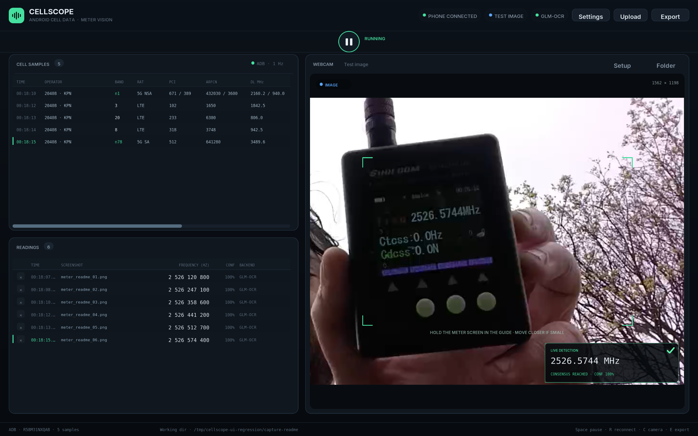
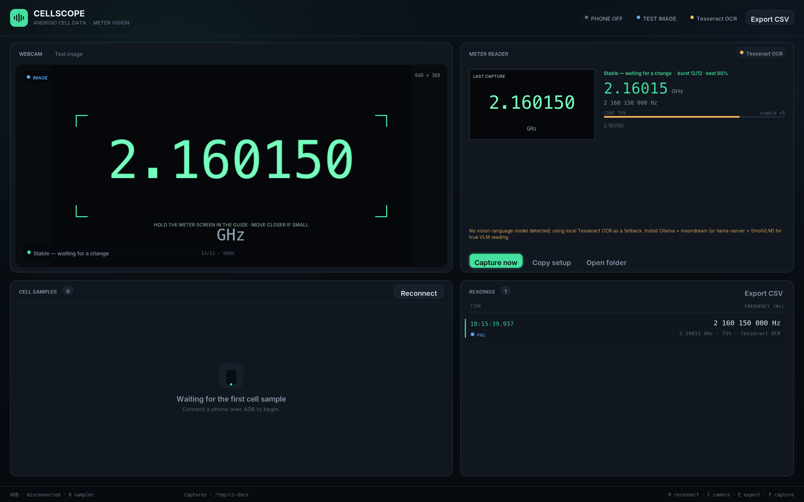

# CellScope

A cross-platform desktop C application that watches an Android phone's cellular
state and a webcam at the same time.

- **Left:** live cell samples polled from `adb` once per second (PLMN, MCC/MNC,
  TAC, eNB/CID, PCI, timing advance, NR/LTE ARFCN, band, bandwidth, CA,
  downlink/uplink centre frequencies).
- **Top left:** webcam preview with a meter alignment guide.
- **Top right:** best-frame frequency reader. It captures a rolling burst of
  frames, scores them for legibility, and sends the sharpest frame to a local
  vision-language model. The reading is parsed, converted to Hz, and the exact
  frame is saved.
- **Bottom right:** timestamped frequency readings.
- **On launch:** a step-by-step modal explains how to connect the phone over
  ADB. It only disappears when a device is authorized; failures show concrete
  fixes.
- **First run:** CellScope installs its own private Python runtime, ML packages,
  and MiniMind assets, then starts the local reader bridge in the background.

Camera frames and readings stay local. No telemetry, no cloud inference, and no
images are uploaded. The one-time runtime/model downloads come from uv's GitHub
releases and ModelScope.



## Stack

| Concern | Choice |
|---|---|
| Language | C11 |
| Window / input / camera | SDL3 (3.2+ camera API) |
| 2D UI / text | SDL3 renderer + FreeType, small immediate-mode toolkit |
| ADB | `adb` subprocess, captured with a hard timeout |
| Reader HTTP | libcurl → Ollama or llama.cpp server (OpenAI-compatible) |
| OCR fallback | Tesseract subprocess |
| PNG | stb_image / stb_image_write |
| Training | MiniMind-V submodule + a small Parquet converter |
| Private runtime | uv-managed CPython 3.11 + venv, auto-installed on first run |
| Local bridge | MiniMind-V PyTorch model behind an OpenAI-compatible HTTP endpoint |

## Build

### macOS

```bash
brew install cmake sdl3 freetype curl
cmake -S . -B build -DCMAKE_BUILD_TYPE=Release
cmake --build build -j
open build/cellscope.app
```

The bundle is ad-hoc signed by the build. Approve the camera prompt the first
time. If you previously denied it, enable **CellScope** in
*System Settings → Privacy & Security → Camera*. Launching the bundle with
`open` is important on macOS; running the raw executable from a terminal can
make TCC attribute camera permission to the terminal instead.

### Windows

Use vcpkg for SDL3, FreeType, and libcurl:

```bat
vcpkg install
cmake -S . -B build -DCMAKE_TOOLCHAIN_FILE=%VCPKG_ROOT%\scripts\buildsystems\vcpkg.cmake
cmake --build build --config Release
build\Release\cellscope.exe
```

Windows camera access is controlled by *Settings → Privacy → Camera*. The app
keeps a console window by default for ADB diagnostics; configure with
`-DCELLSCOPE_WIN_CONSOLE=OFF` for a pure GUI build.

### Linux

```bash
sudo apt install build-essential cmake libfreetype-dev libcurl4-openssl-dev
# SDL3 3.4+ is required for the camera API. If your distro does not package it:
#   git clone https://github.com/libsdl-org/SDL.git -b release-3.2
#   cmake -S SDL -B SDL/build -DCMAKE_BUILD_TYPE=Release && cmake --build SDL/build -j
#   sudo cmake --install SDL/build
cmake -S . -B build -DCMAKE_BUILD_TYPE=Release
cmake --build build -j
./build/cellscope
```

The user must be able to open `/dev/video*` (usually membership in the `video`
group) and must have working Android udev rules for adb.

## Run

```bash
# macOS
open build/cellscope.app
# Linux / Windows
./build/cellscope
```

Just running the binary is enough. On first use CellScope bootstraps its own
local AI runtime, downloads the model files, and starts the MiniMind bridge in the
background.

### First run: private Python + MiniMind

You do not need to install or prepare system Python, pip, virtualenv, uv, or
ModelScope by hand. On the first GUI launch (when not using `--demo`,
`--image`, or an explicit `--vlm`), CellScope:

1. downloads a `uv` launcher into its application-data directory;
2. installs a private CPython 3.11 under that directory;
3. creates a private virtual environment and installs
   `torch`, `torchvision`, `transformers==4.57.6`, `datasets==3.6.0`,
   `numpy==1.26.4`, `pyarrow==23.0.0`, `Pillow`, `safetensors`, and `modelscope`;
4. downloads the frozen SigLIP2 vision encoder and the MiniMind language/base
   SFT weights from ModelScope;
5. starts this in the background with the private interpreter:

```bash
python scripts/serve_minimind_vlm.py \
  --minimind third_party/minimind-v \
  --save_dir ./training \
  --weight cellscope_meter \
  --port 8090
```

The effective paths are absolute and point at the bundled MiniMind checkout. If
`training/cellscope_meter_768.pth` does not exist yet, the same bridge starts
with the downloaded baseline `sft_vlm_768.pth`; train with `--train` to replace
it with a meter-specific checkpoint. A banner shows download/install progress.
The app remains usable with the Tesseract fallback while setup runs.

- macOS: `~/Library/Application Support/CellScope/runtime`
- Linux: `~/.local/share/CellScope/runtime`
- Windows: `%LOCALAPPDATA%\CellScope\runtime`

The setup log is `runtime/bootstrap.log`; the server log is
`runtime/minimind-server.log`. Delete the runtime directory to force a clean
reinstall. Training output defaults to `<project>/training` in a source
checkout, or the app-data `training` directory in a packaged build. Override it
with `CELLSCOPE_TRAINING_DIR`.

Useful flags:

```bash
# build/update the private runtime and exit (no GUI)
cellscope --setup-runtime
# skip the first-run bootstrap
cellscope --no-runtime
# use an external backend instead of the built-in MiniMind runtime
cellscope --vlm ollama --vlm-model moondream
```

`--vlm …`, `--demo`, `--image`, and `--no-runtime` disable the automatic
MiniMind bootstrap. Set `CELLSCOPE_RUNTIME_DIR` to relocate the runtime and
`CELLSCOPE_RUNTIME_PACKAGES` to override the package list for development.

### Readers

Without arguments the app attaches to the MiniMind bridge it started itself.
If the private runtime cannot be installed, or when an explicit backend is
requested, it falls back in this order:

1. **Ollama** with a vision-capable model (`--vlm ollama`)
2. **llama.cpp server** exposing a recognized multimodal model (`--vlm llama`)
3. **Tesseract OCR** fallback (requires `tesseract` on `PATH`)
4. off

Optional external tiny VLM (Ollama):

```bash
ollama pull moondream          # ~1.7 GB, 1.8B params
ollama serve
build/cellscope.app/Contents/MacOS/cellscope --vlm ollama --vlm-model moondream
```

Recommended tiny VLM (llama.cpp, SmolVLM-256M, ~290 MB):

```bash
llama-server -hf ggml-org/SmolVLM-256M-Instruct-GGUF --port 8080
build/cellscope.app/Contents/MacOS/cellscope \
  --vlm llama --vlm-url http://127.0.0.1:8080
```

The reader prompt asks for JSON only:

```json
{"visible":true,"reading":"2160.150","unit":"GHz","confidence":0.93}
```

`reading` is converted to Hz in C. Supported units: `Hz`, `kHz`, `MHz`, `GHz`.
If a bare number has no unit, `--unit` (default `MHz`) is used. Tesseract is a
fallback, not a VLM; it OCRs the digit crop and the bottom/right unit strip, and
is labeled as such in the UI.

### Burst capture and best-frame selection

A person holding a pocket meter cannot hold it perfectly still. CellScope keeps
the last **12 camera frames** (roughly 1.5 s at the camera's capture rate) and
scores each frame's central guide area for:

- Laplacian/gradient sharpness (focus / motion blur)
- local contrast
- edge density (text-like structure)
- blown highlights (glare)
- crushed shadows

The reader consumes the highest-scoring unused frame, with a score threshold so
a blank wall does not trigger OCR. When a reading is accepted, the screenshot is
the exact best frame that produced it. The UI shows `burst 12/12 · best 90%`.



### ADB connection

On first launch CellScope shows:

1. Enable Developer options (tap *Build number* seven times).
2. Enable *USB debugging*.
3. Connect with a data cable and choose *File transfer* / accept debugging.
4. Tap **Allow** on the phone and tick *Always allow*.

Then click **Check connection**. While the modal is open, failed checks retry
every four seconds. The app also explains missing `adb`, unauthorized devices,
offline devices, USB permission problems, and multiple attached devices. For
wireless debugging, pair once:

```bash
adb pair PHONE_IP:PAIR_PORT
adb connect PHONE_IP:DEBUG_PORT
```

The poller runs `adb shell dumpsys telephony.registry` once per second. No root
is required. Field availability varies by OEM, Android version, and carrier;
some devices redact NR fields unless a debug/test menu is enabled. Missing
values are shown as `—`, and the raw dump of the last parse failure is written
to the capture directory for diagnosis.

### Controls

| Key | Action |
|---|---|
| `R` | reconnect ADB |
| `C` | cycle cameras |
| `E` | export CSV |
| `F` | capture the best buffered frame now |
| `Esc` | dismiss the connection modal |

`Export CSV` writes both `readings_*.csv` and `cells_*.csv` to the capture
directory. Captures default to `Pictures/CellScope` (or `--capture-dir`).

## Training a meter reader with MiniMind-V

The repository includes
[MiniMind-V](https://github.com/jingyaogong/minimind-v) as a git submodule.
CellScope's `--train` switch turns a folder of meter photos plus a
`filename,freq` CSV into a MiniMind-V SFT Parquet, invokes the real upstream
`train_sft_vlm.py`, and prints the command that serves the trained weights.

### 1. Dataset

```text
meter_dataset/
  IMG_0012.jpg
  IMG_0013.png
  labels.csv
```

```csv
filename,freq
IMG_0012.jpg,2160.150 MHz
IMG_0013.png,2.160150 GHz
IMG_0014.jpg,940.0MHz
```

- Filenames are relative to the dataset folder; absolute paths also work.
- The value may include a unit. Without a unit, `--train-unit` (default `MHz`)
  is used; a bare large number is tried as Hz.
- Photograph the actual meters the app will see: handheld, slightly angled,
  different distances, lighting, glare, and backgrounds. Include the unit
  printed on the display in frame. 200+ varied images is a better starting
  point than dozens.
- A single CSV is auto-detected. Use `--train-csv` if there are several.

### 2. Runtime

`--train` uses the same private Python runtime described above. On first use it
installs CPython, PyTorch, Transformers, Datasets, pyarrow, Pillow, ModelScope,
and downloads SigLIP2 plus the MiniMind base weights automatically. No manual
`pip`, venv, or ModelScope commands are needed. The source checkout must have
the MiniMind-V submodule:

```bash
git submodule update --init --recursive
```

`--train-dry-run` installs the same Python runtime but stops after the Parquet
is built (it does not require SigLIP2 or the base weights).

### 3. Train

```bash
# Validate the CSV and build the Parquet only
./build/cellscope.app/Contents/MacOS/cellscope \
  --train ./meter_dataset --train-out ./training --train-dry-run

# SFT (CUDA recommended; mps/cpu also work in the upstream trainer)
./build/cellscope.app/Contents/MacOS/cellscope \
  --train ./meter_dataset \
  --train-out ./training \
  --train-epochs 2 \
  --train-batch 4 \
  --train-augment 2 \
  --train-device cuda:0
```

Useful options:

| Option | Meaning |
|---|---|
| `--train-csv FILE` | choose the labels CSV explicitly |
| `--train-out DIR` | output; default `<project>/training` (or app-data `training`) |
| `--train-minimind PATH` | alternate MiniMind-V checkout |
| `--train-unit UNIT` | unit for bare CSV numbers |
| `--train-augment N` | extra handheld/augmented variants per image |
| `--train-hidden N` / `--train-layers N` | model dimensions (default 768 / 8) |
| `--train-lr F` | learning rate (default `5e-6`) |
| `--train-resume` | resume from the upstream checkpoint |
| `--train-dry-run` | stop after the Parquet is built |
| `--train-device DEV` | `cuda:0`, `mps`, or `cpu` |

Outputs:

```text
training/
  cellscope_dataset.csv      # normalized manifest
  prompt.txt                 # exact prompt used for training
  cellscope_meter.parquet    # MiniMind-V SFT dataset
  cellscope_meter_768.pth    # trained weights (after SFT)
```

Under the hood the C binary:

0. ensures the private Python runtime and downloads MiniMind assets;
1. validates every image and frequency, converts to Hz, and writes a normalized
   CSV;
2. runs `scripts/prepare_minimind_dataset.py`, which embeds the images and
   builds a Parquet with `conversations` + `image_bytes` columns;
3. runs the upstream `trainer/train_sft_vlm.py` from the submodule with
   `--from_weight llm --freeze_llm 1`.
4. prints the serving command.

### 4. Use the trained model with CellScope

Nothing else is required. Once `training/cellscope_meter_768.pth` exists, the
next launch starts the bridge with it automatically:

```bash
./build/cellscope.app/Contents/MacOS/cellscope
```

The bridge loads the checkpoint, accepts the app's `image_url` base64 payload,
prepends MiniMind-V's image tokens, and returns an OpenAI-style
`choices[0].message.content` answer. The header and reader pill switch to
**MiniMind · local**. If you want to run the bridge manually (for example from
another machine), use the printed command:

```bash
python scripts/serve_minimind_vlm.py \
  --minimind third_party/minimind-v \
  --save_dir ./training --weight cellscope_meter --port 8090
```

and point an explicit backend at it with
`--vlm llama --vlm-url http://127.0.0.1:8090`.

> Training quality depends on the dataset. A 65M-parameter VLM is good at a
> narrow, repetitive task like reading one meter model; it is not a general OCR
> engine. Keep the training photos close to the deployment pose and verify with
> real captures. The app's burst selector and two-consistent-readings rule
> reduce accidental readings, but review recorded values.

## Architecture

```text
first run: uv → CPython 3.11 → venv → packages → SigLIP2 + MiniMind
                                              │
                                              ▼
                                   MiniMind bridge :8090
                                              │
Camera (SDL3) 8 fps                           │
   │  RGB frames                               │
   ▼                                          │
Burst ring (12) ── quality score ──► best unused frame
                                              │
                                              ▼
                              MiniMind / Ollama / llama.cpp / Tesseract
                                              │  JSON / text
                                              ▼
                                    meter parser → Hz
                                              │
                    2 stable samples ──► readings list + PNG
                                              ▲
                    adb poller (1 s) ── telephony.registry
```

Source map:

| Path | Role |
|---|---|
| `src/app.c` | lifecycle, threads, ADB/VLM workers, burst, CSV, screenshots |
| `src/app_ui.c` | layout, camera panel, lists, modal, reader UI |
| `src/ui.c` / `src/fonts.c` | renderer, text cache, widgets, rounded shapes |
| `src/adb.c` / `src/proc.c` | device discovery, timeout-safe subprocesses |
| `src/telephony.c` / `src/cellular.c` | dumpsys parsing, PLMN, ARFCN→Hz tables |
| `src/camera.c` | SDL3 camera, permission handling, RGB snapshots |
| `src/quality.c` | frame legibility scoring |
| `src/meter.c` | unit parsing, stability tracker |
| `src/vlm.c` | Ollama/llama server/Tesseract backends |
| `src/train.c` | `--train` pipeline |
| `src/runtime.c` | uv/Python/venv/packages/model bootstrap |
| `src/server.c` | MiniMind bridge spawn, health check, shutdown |
| `scripts/` | Parquet builder and MiniMind-V inference bridge |
| `third_party/minimind-v` | upstream training/vision code (submodule) |

## Tests

```bash
ctest --test-dir build --output-on-failure
```

The test suite covers PLMN splitting, LTE/NR ARFCN conversions, a realistic
telephony dump, meter units/commas/JSON, stability/debouncing, frame-quality
ordering, JSON helpers, base64, and frequency formatting.

A camera-free end-to-end reader test:

```bash
# generate a synthetic meter image, then:
./build/cellscope.app/Contents/MacOS/cellscope \
  --image meter.png --vlm tesseract --no-modal \
  --capture-dir /tmp/cellscope-test \
  --screenshot /tmp/cellscope-test/app.png --screenshot-delay 5000
```

`--demo` runs the full UI with synthetic cell samples and a synthetic meter
feed, with no phone or camera.

Runtime bootstrap smoke test (uses a light package set and does not download
models):

```bash
CELLSCOPE_RUNTIME_DIR=/tmp/cellscope-runtime \
CELLSCOPE_RUNTIME_PACKAGES=pyarrow,pillow \
CELLSCOPE_SKIP_MODELS=1 \
./build/cellscope.app/Contents/MacOS/cellscope --setup-runtime
```

## Known limitations

- Some carriers/OEMs do not expose NR or timing-advance fields through
  `dumpsys`; CellScope cannot invent them.
- Frequencies are derived from 3GPP band tables for common FDD/TDD bands.
  Unknown bands are shown as `—` rather than guessed.
- The Tesseract fallback is not a VLM and is more sensitive to glare/angle.
  Prefer Ollama or llama.cpp for production.
- Lists are in memory. Use **Export CSV** to persist.
- First-run setup needs network and enough disk for PyTorch plus MiniMind
  assets (several GB, especially on Linux CUDA wheels). The banner shows
  progress; deleting the runtime directory forces a clean retry.
- Until you train, the automatic reader uses the upstream generic MiniMind SFT
  checkpoint, which is not meter-specific. Train with `--train` for accuracy.
- If you train into a non-default directory, set `CELLSCOPE_TRAINING_DIR` so the
  boot-time server finds `cellscope_meter_768.pth`.
- The private environment installs PyPI wheels. A CUDA-specific PyTorch build
  may need manual `uv pip install` into the private venv for GPU training.
- MiniMind-V model weights are not shipped in the repository; they are fetched
  on first run or by `--setup-runtime`.

## Licenses

CellScope code is MIT (see `LICENSE`). Inter is SIL OFL, DejaVu is under the
Bitstream Vera license (see `assets/licenses/`), stb is public domain/MIT, and
MiniMind-V is Apache-2.0 (see `third_party/minimind-v/LICENSE`).
